# Food Express
Esse projeto foi originalmente desenvolvido por Daniel Ohata (https://github.com/dr-ohata/foodexpress). Utilizado na disciplina de UX e Testes de Software.git commit -m "docs: atualiza README com a documentação completa da atividade"

# Testes Caixa Cinza em API de Autenticação (Supabase + Postman)

**Aluno:** Kaike Figueiredo — GitHub: [Kaike-figueiredo9](https://github.com/Kaike-figueiredo9)
**Instituição:** UniFacens

---

## Introdução

Este repositório documenta a atividade de **testes de caixa cinza** em uma API de autenticação. O ambiente de autenticação foi criado no **Supabase**, e os testes foram executados no **Postman Desktop**, com toda a documentação reunida neste `README.md`.

Estrutura do repositório:

```
/README.md
/postman/    -> collection e environment exportados do Postman
/prints/     -> evidências (prints) de todas as etapas
/planilha/   -> planilha de registro dos testes
```

---

## Objetivo da Atividade

Compreender e aplicar testes de caixa cinza em APIs de autenticação, usando ferramentas de mercado para configurar, executar e validar testes funcionais. Na atividade foram feitos:

- configuração de um ambiente de autenticação no Supabase;
- criação de um usuário para testes;
- envio de requisições HTTP e análise das respostas;
- execução dos testes no Postman;
- validação de status HTTP, JSON, mensagens de erro e access token;
- documentação técnica de todo o processo.

Como é um teste de caixa cinza, o conhecimento do sistema é parcial: são conhecidos o endpoint, o método de autenticação, os headers, o body JSON e as respostas HTTP, mas não o código interno do servidor.

---

## Configuração do Supabase

**Como o projeto foi criado:** criei uma conta no Supabase, gerei uma organização e um novo projeto chamado **FoodExpress** (ambiente `main`, plano Free).

**Tipo de autenticação:** autenticação por **e-mail e senha** (provider *Email* habilitado em *Authentication > Sign In / Providers*).

**Como o usuário foi criado:** pelo painel, em *Authentication > Users*, adicionei um usuário de teste com e-mail e senha.

**Credenciais obtidas:** a **API URL** do projeto e a **publishable key**, em *Project Settings > API Keys*. Essas informações alimentam as variáveis do Postman.

**Objetivo da configuração:** ter uma API de autenticação real, com um usuário válido, para servir de alvo dos testes.

### Evidências

**Projeto criado:**

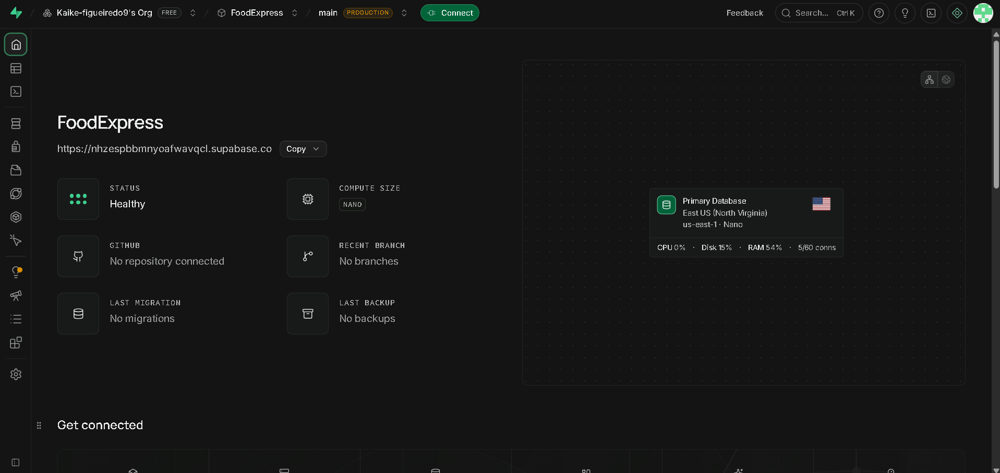

**Autenticação por e-mail habilitada:**

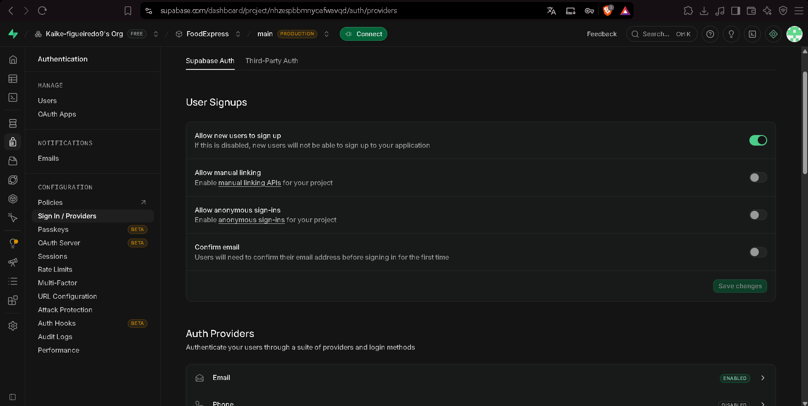

**Usuário criado:**

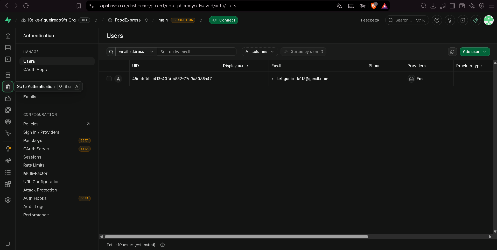

**Credenciais da API (chave parcialmente oculta):**

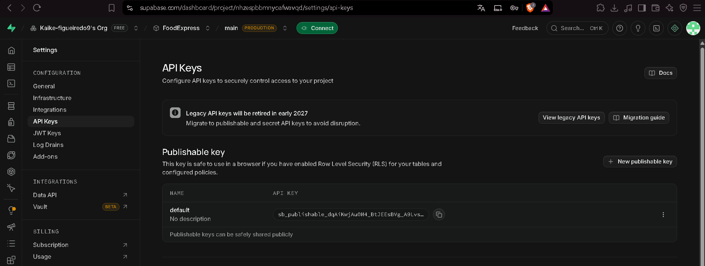

A identificação do aluno aparece nos prints (organização `Kaike-figueiredo9's Org` e e-mail do usuário).

> Observação: no print de *Sign In / Providers*, a opção **Confirm email** está desativada, ou seja, o usuário consegue fazer login sem confirmar o e-mail. Isso foi mantido para facilitar os testes (ver melhorias na Conclusão).

---

## Configuração do Postman

**Workspace:** criei o workspace pessoal `Kaike Figueiredo's Workspace` no Postman Desktop.

**Environment:** criei o environment **FoodExpress**, ativo durante todos os testes.

**Variáveis configuradas:**

| Variável | Descrição |
|---|---|
| `base_url` | URL da API do Supabase |
| `api_key` | API KEY (publishable key) |
| `email` | E-mail do usuário criado |
| `senha` | Senha do usuário criado (equivale à variável `password` pedida na atividade) |
| `access_token` | Reservada para guardar o token retornado no login |

**Finalidade das variáveis:** evitam repetir a URL e as credenciais em cada requisição e permitem trocar o ambiente sem editar as requisições.

**Como o Postman é usado nos testes:** a collection **Testes Funcionais - Caixa Cinza** reúne as 5 requisições, uma por cenário. Todas usam o environment FoodExpress.

### Evidências

**Environment e variáveis (senha oculta):**

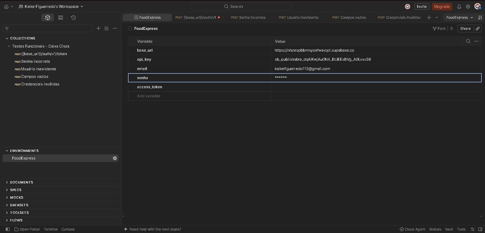

**Workspace e organização da collection:**

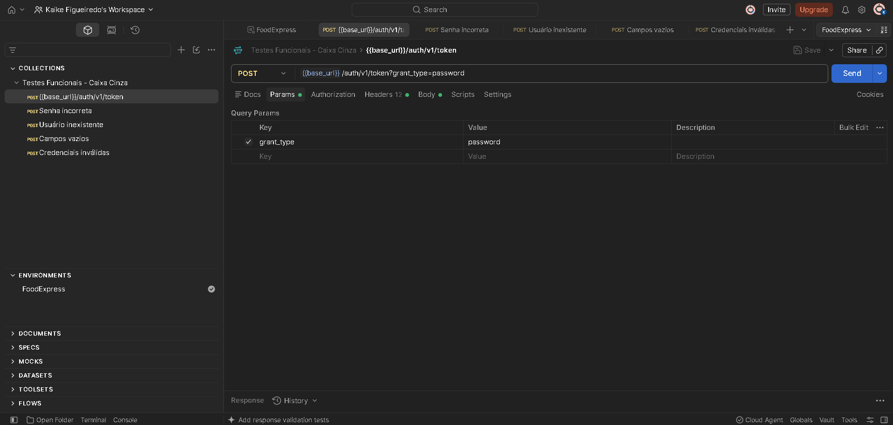

---

## Configuração das Requisições

- **Endpoint:** `{{base_url}}/auth/v1/token?grant_type=password`
- **Método HTTP:** `POST`
- **Finalidade:** autenticar o usuário com e-mail e senha e obter um token de acesso (`access_token`).

**Headers utilizados:**

| Header | Valor |
|---|---|
| `apikey` | `XXXXX` (valor de `{{api_key}}`) |
| `Content-Type` | `application/json` |
| `Authorization` | `Bearer XXXXX` (valor de `{{api_key}}`) |

**Body JSON utilizado:**

```json
{
  "email": "{{email}}",
  "password": "{{senha}}"
}
```

Exemplo com valores fictícios:

```json
{
  "email": "usuario@email.com",
  "password": "123456"
}
```

### Evidências

**Endpoint e método:**

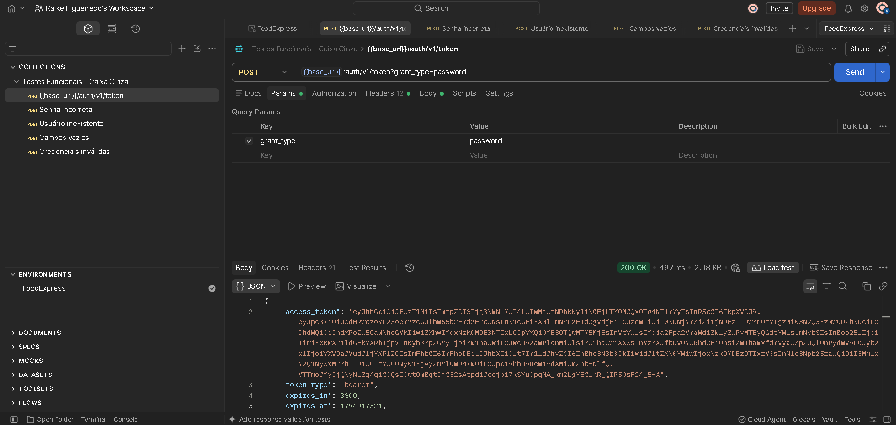

**Headers:**

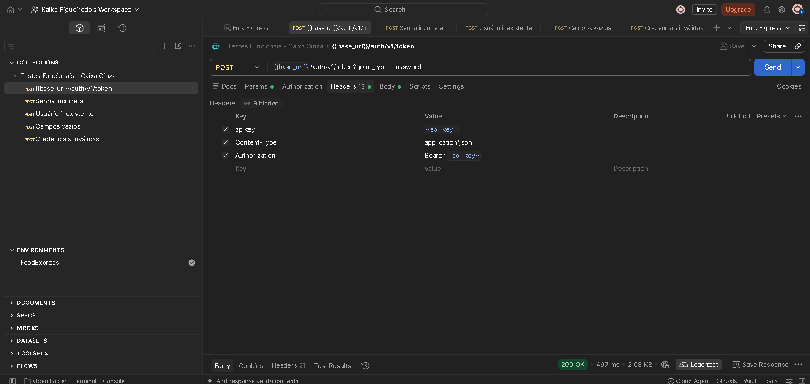

**Body JSON:**

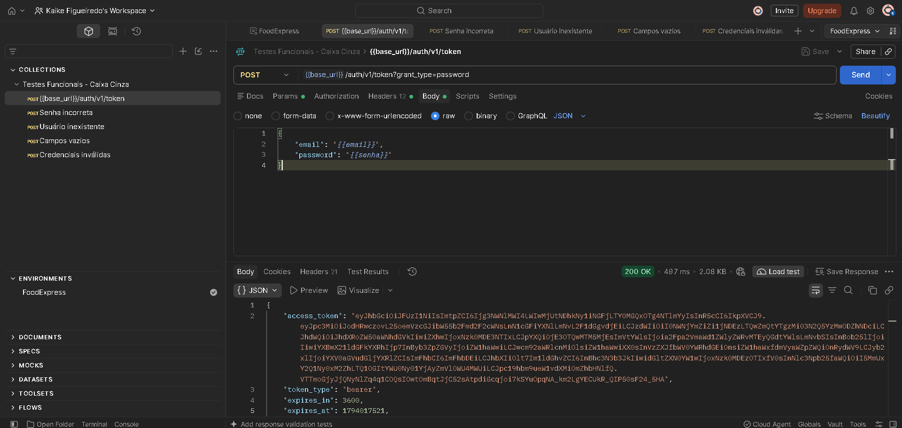

---

## Execução dos Testes

Foram executados os 5 cenários obrigatórios, todos com a mesma requisição (`POST /auth/v1/token?grant_type=password`), alterando apenas o body.

### Tabela de Cenários

| Cenário | Entrada Utilizada | Resultado Esperado | Resultado Obtido | Status |
|---|---|---|---|---|
| Login válido | E-mail e senha corretos | Status 200 + access token | 200 OK, com `access_token` | OK |
| Senha incorreta | E-mail correto + senha errada | Erro de autenticação | 400, `invalid_credentials`, "Invalid login credentials" | OK |
| Usuário inexistente | E-mail não cadastrado + senha | Acesso negado | 400, `invalid_credentials`, "Invalid login credentials" | OK |
| Campos vazios | E-mail e senha vazios | Erro de validação | 400, `validation_failed`, "missing email or phone" | OK |
| Credenciais inválidas | E-mail inexistente + senha errada | Mensagem de erro | 400, `invalid_credentials`, "Invalid login credentials" | OK |

### Evidências

**Login válido (200 OK + access token):**

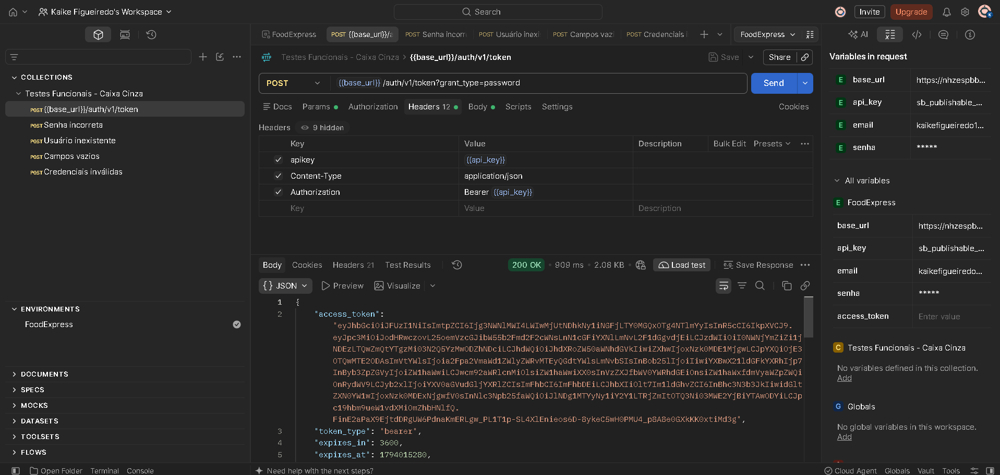

**Senha incorreta:**

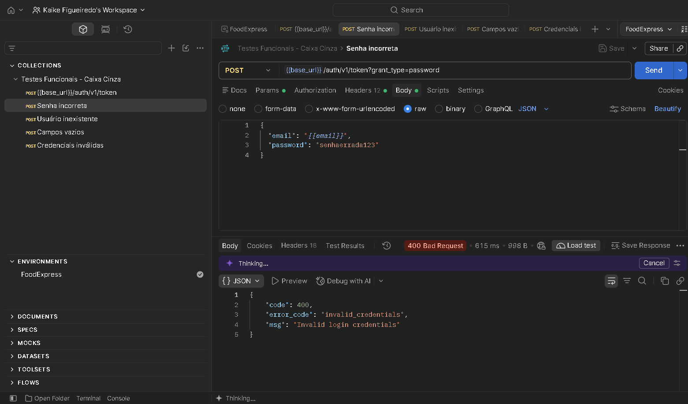

**Usuário inexistente:**

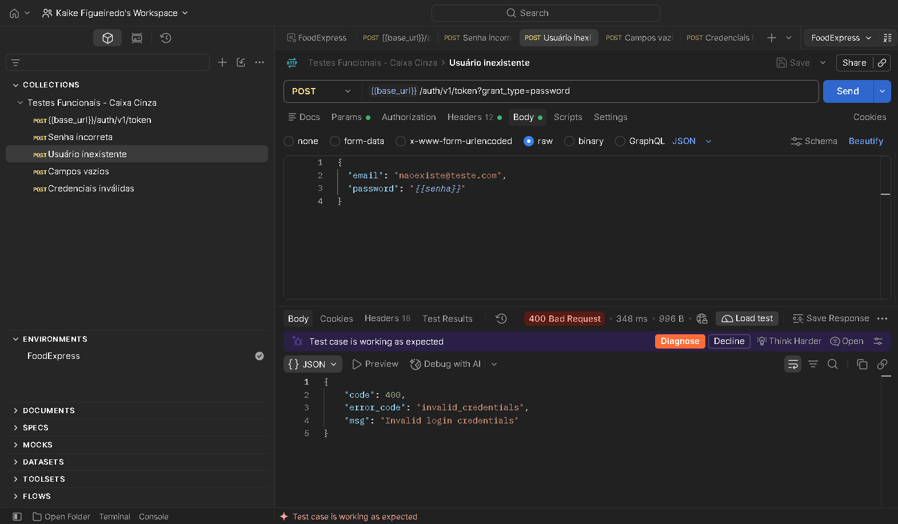

**Campos vazios:**

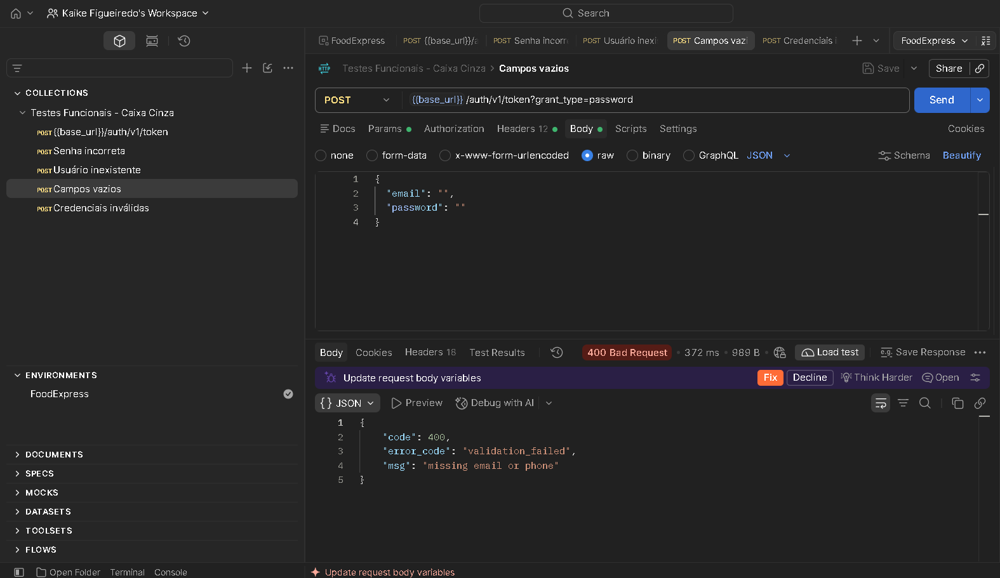

**Credenciais inválidas:**

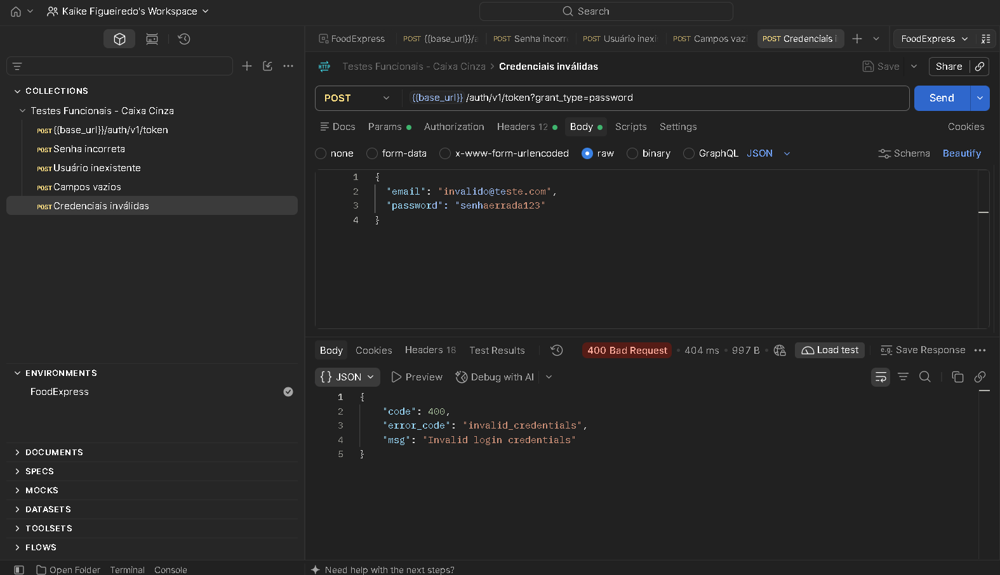

### Erros encontrados durante a execução

- O Supabase responde **400** (e não 401/403) para credenciais erradas.
- Senha incorreta, usuário inexistente e credenciais inválidas retornam **a mesma resposta**, então não dá para distinguir os casos só pela resposta.
- Campos vazios é o único cenário com `error_code` diferente (`validation_failed`).

---

## Registro dos Testes

**Como os testes foram registrados:** em uma planilha (`planilha/planilha-testes.xlsx`) com ID do teste, cenário, entrada, resultado esperado, resultado obtido, status e observações. Cada linha corresponde a um cenário executado.

**Importância da documentação dos testes:** permite repetir os testes, comparar resultados entre versões, provar o que foi executado e facilitar a análise de falhas por outras pessoas.

**Falhas identificadas:** nenhum cenário falhou em relação ao esperado. Os pontos de atenção estão nas observações da planilha (código 400 em vez de 401/403 e respostas idênticas para casos diferentes).

### Exemplos de registros

| ID | Cenário | Resultado obtido | Status |
|---|---|---|---|
| CT01 | Login válido | 200 OK + `access_token` | Sucesso |
| CT02 | Senha incorreta | 400 `invalid_credentials` | Sucesso |
| CT04 | Campos vazios | 400 `validation_failed` | Sucesso |

**Print da planilha preenchida:**

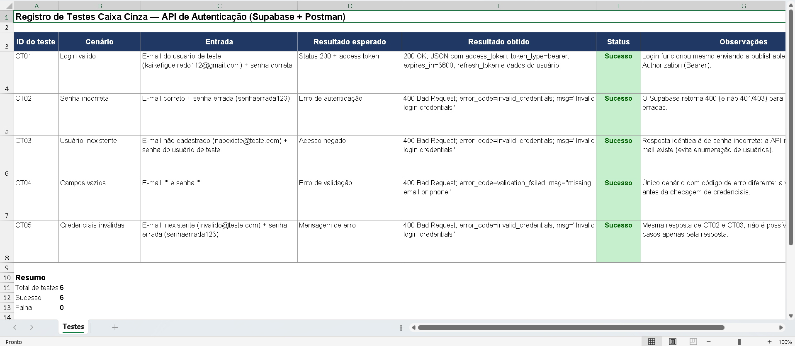

---

## Resultados Obtidos

| ID | Cenário | Status HTTP | `error_code` | Mensagem |
|---|---|---|---|---|
| CT01 | Login válido | 200 OK | n/a | `access_token` retornado (`token_type: bearer`, `expires_in: 3600`) |
| CT02 | Senha incorreta | 400 Bad Request | `invalid_credentials` | Invalid login credentials |
| CT03 | Usuário inexistente | 400 Bad Request | `invalid_credentials` | Invalid login credentials |
| CT04 | Campos vazios | 400 Bad Request | `validation_failed` | missing email or phone |
| CT05 | Credenciais inválidas | 400 Bad Request | `invalid_credentials` | Invalid login credentials |

**Resumo:** 5 testes executados, 5 com o comportamento esperado.

---

## Conclusão

**Os testes foram executados corretamente?** Sim. Os 5 cenários obrigatórios foram executados por mim, no Postman, com evidências reais de cada um.

**A autenticação funcionou?** Sim. O login válido retornou 200 OK com `access_token`, e todas as entradas inválidas foram rejeitadas com erro e mensagem claros.

**Dificuldades encontradas:**

- No início, a requisição tinha só os headers `apikey` e `Content-Type`; faltava o **`Authorization`** exigido pela atividade, que foi adicionado depois.
- A variável do environment estava com o nome `senha`, enquanto a atividade pede `password`. Mantive `senha` e documentei a equivalência.
- Alguns prints exibiam dados sensíveis (senha no painel de variáveis, `refresh_token` e chave completa), então foi preciso cobrir esses trechos antes de publicar.
- Foi necessário organizar o projeto base no VS Code, criando as pastas `postman`, `prints` e `planilha` e cuidando para não subir o `.env`.

**Falhas identificadas:**

- O Supabase retorna **400** para credenciais erradas, em vez de 401/403.
- Senha incorreta, usuário inexistente e credenciais inválidas dão a mesma resposta. É bom para segurança (não revela se o e-mail existe), mas dificulta diagnosticar o caso exato.
- **Confirm email** está desativado, então um e-mail não confirmado já consegue autenticar.

**Melhorias que poderiam ser implementadas:**

- Ativar a confirmação de e-mail em ambientes reais.
- Exigir senhas mais fortes (a senha de teste era fraca).
- Automatizar os testes com scripts de teste do Postman (validar status e salvar o `access_token` na variável).
- Adicionar testes de limite de tentativas (rate limit) e de expiração do token.
- Guardar segredos no cofre do Postman, sem deixá-los em texto aberto.

**Importância dos testes caixa cinza em APIs:** combinam o conhecimento parcial da estrutura (endpoint, headers, body) com a validação do comportamento real. Assim é possível verificar contratos, códigos de status, mensagens de erro e pontos de segurança sem precisar do código-fonte, antes que os problemas cheguem ao usuário final.
